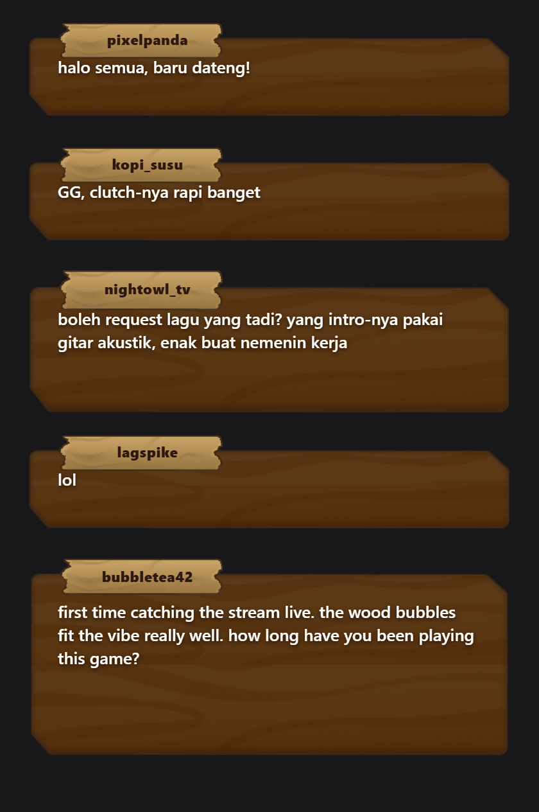

# chaBubbleTwitch

A free Twitch chat overlay for OBS that shows each chat message as a wooden speech bubble.



Live page with a step-by-step guide (in Indonesian): https://ramaraihan.is-a.dev/chaBubbleTwitch/

## Use it in OBS

1. In OBS, add a **Browser** source.
2. Set the URL to the overlay with your channel name at the end:

   ```
   https://ramaraihan.is-a.dev/chaBubbleTwitch/chat-bubble.html?channel=yourchannel
   ```

   Use the name from your Twitch link. For `twitch.tv/yourchannel`, that's `yourchannel`.
3. Set **Width** to 400 and **Height** to 600.
4. Untick **Shutdown source when not visible**, so the overlay stays connected when you switch scenes.

Chat appears in the bottom-right corner of the source. Move and resize the source like any other.

You can also leave out `?channel=`. Then the page shows a text box and a Connect button: right-click the source, pick **Interact**, type your channel name and click **Connect**. You have to do that again every time OBS starts, so the URL is easier.

## URL parameters

| Parameter | Example | What it does |
| --- | --- | --- |
| `channel` | `?channel=yourchannel` | Connects to that channel when the page loads and hides the text box. |
| `demo` | `?demo=1` | Shows sample messages and doesn't connect to Twitch. Good for checking the look or taking screenshots. Works offline. |

There are no other options. Size, position and the bubble style are set in `chat-bubble.html`.

## Limits

- Only Twitch emotes show as images. BTTV, FFZ and 7TV emotes show as plain text.
- At most 6 bubbles are on screen. Each new message pushes the oldest one out. Bubbles don't disappear on a timer.
- Usernames are always dark brown so they're readable on the paper label. Twitch name colors aren't used.
- Long usernames are cut off with "…". A bubble holds about 7 lines of text, and the rest of a longer message is cut off.
- Messages that mods delete, and messages from banned users, stay up until newer messages push them out.
- Bot messages and commands like `!discord` show like any other message.
- It needs internet to reach Twitch and to load tmi.js (except in demo mode).

## How it works

The overlay is a single HTML file with no build step. It uses [tmi.js](https://github.com/tmijs/tmi.js) to join your channel's chat over Twitch IRC (on a WebSocket) as an anonymous, read-only guest. There's no login and no token is stored anywhere, because reading public chat doesn't need one.

For each message, the page measures the text and picks a 1-, 2- or 3-line bubble image. Emotes use the positions Twitch sends with each message and load from Twitch's emote CDN.

tmi.js loads from jsDelivr, pinned to version 1.9.0-pre.1 with an integrity hash. That's the newest tmi.js release on npm that includes a browser build.

## License

MIT. See [LICENSE](LICENSE).

Made by [Rama Raihan](https://github.com/ramaraihan12).
